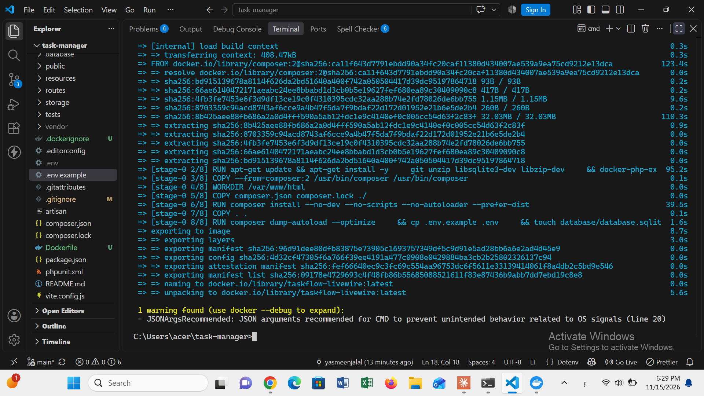
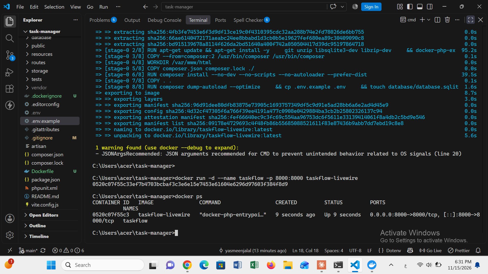
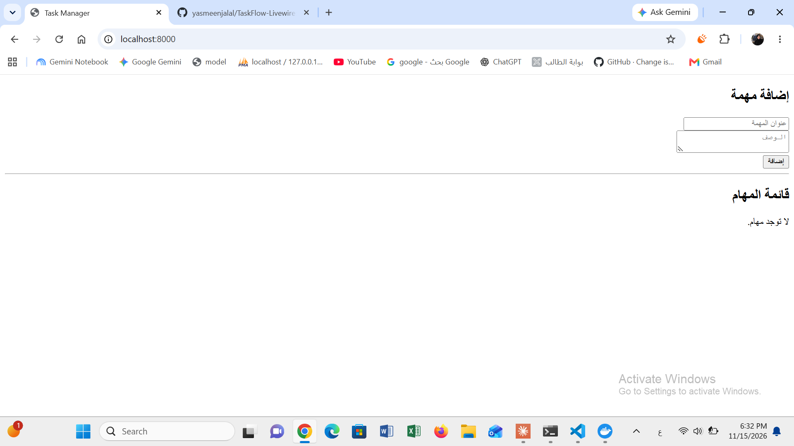

# TaskFlow-Livewire

A Laravel & Livewire task management web app with full CRUD: add, edit and delete tasks, and change their status (pending / in progress / done). Containerized with Docker.

## Tech Stack

- PHP 8.2
- Laravel
- Livewire
- SQLite
- Docker

## Features

- Add a task (title + description)
- Edit and delete tasks
- Change task status: pending, in progress, done
- Data persisted in SQLite

## Run with Docker

### Prerequisites

- [Docker](https://www.docker.com/products/docker-desktop/) installed and running
- [Git](https://git-scm.com/)

### Steps

```bash
# 1. Clone the repository
git clone https://github.com/yasmeenjalal/TaskFlow-Livewire.git
cd TaskFlow-Livewire

# 2. Build the image
docker build -t taskflow-livewire .

# 3. Run the container
docker run -d --name taskflow -p 8000:8000 taskflow-livewire
```

Then open **http://localhost:8000** in your browser.

## Stop and Clean Up

```bash
# Stop the container
docker stop taskflow

# Remove the container
docker rm taskflow

# (Optional) Remove the image
docker rmi taskflow-livewire
```

## Configuration

| Item | Value |
|---|---|
| Container port | 8000 |
| Host port | 8000 (change with `-p 9000:8000`) |
| Database | SQLite (created automatically inside the container) |
| Environment | `.env` is generated from `.env.example` during the build |

> Note: data is stored inside the container, so it is lost when the container is removed.

## How to Test

1. Open http://localhost:8000
2. Enter a title and description, then click **إضافة** (Add)
3. The task appears in the task list
4. Try the status buttons, **تعديل** (Edit) and **حذف** (Delete)

## Screenshots

| Docker build | Container running | App working |
|---|---|---|
|  |  |  |

## Attribution

This is an original project written by the repository owner. Built with [Laravel](https://laravel.com) and [Livewire](https://livewire.laravel.com), both open source under the MIT license.